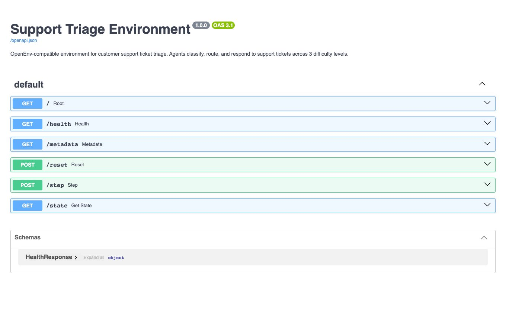

# Support Triage Environment

A deterministic OpenEnv-compatible simulator for training and evaluating agents on customer-support ticket triage.

**Live demo:** no verified Space URL is recorded here; run the local API below.



## What it does

- Generates seeded episodes from 16 synthetic ticket templates.
- Grades priority, category, sentiment and team-routing decisions.
- Adds response drafting and escalation decisions at the hardest task level.
- Exposes local Python, HTTP and WebSocket interfaces.
- Provides separate HF-compatible and OpenAI-compatible inference runners.

## Run locally

Python 3.10+ is declared; the repository baseline was checked with Python 3.11.
From the repository root, create an environment and install the declared extras:

```bash
python3 -m venv .venv
source .venv/bin/activate
python -m pip install -e ".[dev]"
python -m uvicorn server.app:app --host 127.0.0.1 --port 8000
```

Open [local API documentation](http://localhost:8000/docs). No model key is needed to run the environment or tests.
Model-driven inference is optional; see [local development](docs/LOCAL_DEVELOPMENT.md) for its separate dependencies and configuration.

## Tests

```bash
python -m pytest tests/ -v
python -m pip wheel --no-deps --wheel-dir dist .
```

Tests cover models, seeded data, graders, environment lifecycle and HTTP behavior. CI runs tests and a package build on pushes and pull requests.
Lint and static type-check tooling are not configured. A successful package build does not establish that the installed package works; see the known packaging limit below.

## Architecture

| Layer | Implementation |
| --- | --- |
| Models | Pydantic action, observation and state definitions in `models.py` |
| Episodes | `server/support_triage_environment.py` and seeded ticket generation |
| Scoring | Task-specific deterministic graders in `tasks/` |
| API | FastAPI HTTP and WebSocket handlers in `server/app.py` |
| Client | Local/HTTP client in `client.py` |
| Deployment | Docker; OpenEnv manifest and Hugging Face README metadata |

See [architecture](docs/ARCHITECTURE.md) and [grading](docs/GRADING.md).

## Known limits

The built wheel omits root `models.py` and `client.py`; run from the source checkout until packaging is repaired.
HTTP requests share one environment instance; WebSocket connections have separate sessions. This is not a multi-user production service.
Scoring uses deterministic labels and response heuristics, not independent semantic evaluation. No measured model-performance claims are included.
The Space metadata specifies port 7860 while both Docker commands bind 8000; the actual Space configuration remains unverified.
Both Dockerfiles and inference runners remain because their consumers differ. The repository name and package name also remain unchanged pending a naming decision.

## Licence

Existing source headers and package/manifest metadata declare BSD/BSD-3-Clause, but no licence file is present.
The requested MIT transition is pending reconciliation with those declarations; no attribution or licence metadata has been changed.

## Credits

Maintained in [Deftsalt-debug/Openenv_Support_ticket-sim](https://github.com/Deftsalt-debug/Openenv_Support_ticket-sim).
The existing manifest credits OpenEnv Community. Original author and AI co-author attribution remains in source and Git history.
Built around the [OpenEnv](https://github.com/meta-pytorch/OpenEnv) interface with FastAPI and Pydantic.
